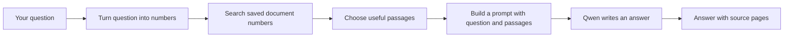
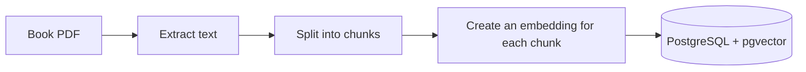
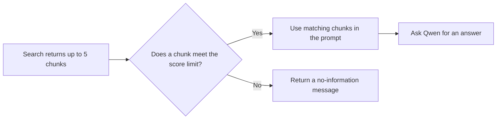
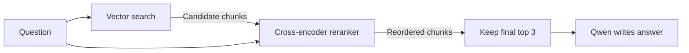
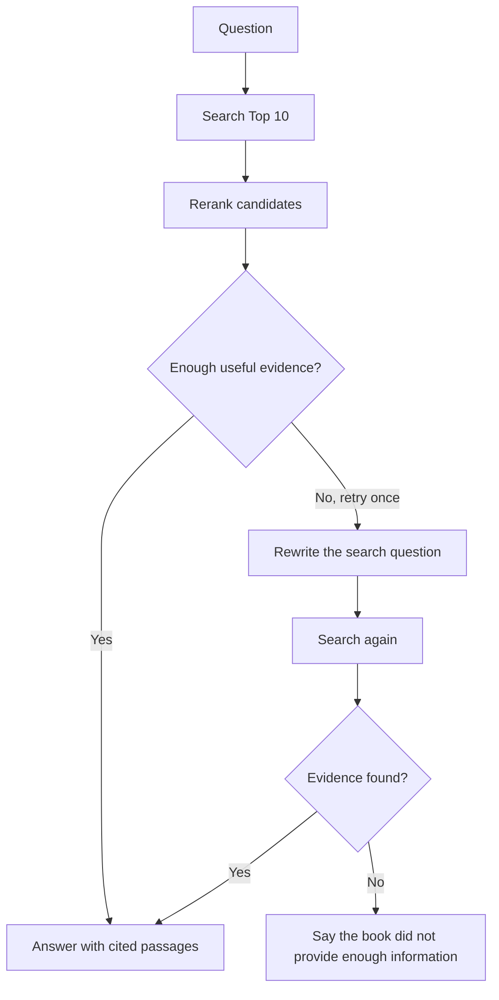

# Learning RAG Locally — Simple Notes

These notes explain what we built while learning to make a local RAG app. They are written for review and sharing.

**Chat:** [Rag Building Locally](https://chatgpt.com/c/6aeb72ba-0590-83ec-b15b-9ddc4d457e04)  
**Updated:** 14 November 2026

> Some numbers below came from experiments in the chat. They are examples from this one book and app, not rules that work for every project.

## 1. What is RAG?

**RAG** means **Retrieval-Augmented Generation**. In simple terms:

1. Find useful passages in your documents.
2. Give those passages and the question to an AI model.
3. Ask the model to write an answer using those passages.

The model does not have to memorize your book. Your app searches the book when a question arrives.

### The whole process



The number lists used by search are called **embeddings**. They represent the meaning of text in a form that a computer can compare.

## 2. The two parts of the app

### A. Prepare the book once

This is called **ingestion** or **indexing**.



A **chunk** is one small piece of the book. The conversation described 441 chunks, 768-number embeddings, and a starting chunk size of about 1,000 characters with 200 characters repeated between nearby chunks.

The repeated text is called **overlap**. It helps keep a sentence or idea together if it falls near a chunk boundary. Too much overlap can make search return repeated information.

### B. Answer each question

This happens every time someone asks something.

```text
Question
  → make a question embedding
  → find nearby book chunks
  → choose the best chunks
  → give question + chunks to Qwen3
  → return answer and sources
```

The models have separate jobs:

| Part | Job |
|---|---|
| Nomic Embed Text | Turns text into number lists for searching |
| PostgreSQL + pgvector | Saves those number lists and finds nearby ones |
| Qwen3 4B | Reads the question and passages, then writes an answer |
| Spring Boot | Connects the API, database, and models |

For this project, document text was embedded with the prefix `search_document:` and questions with `search_query:`. The vectors need the same number of dimensions to compare. Here, both are 768-dimensional.

## 3. How search works

### Meaning-based search

Search does not only look for exact matching words. It compares embeddings to find text with a similar meaning.

That is useful, but it has a limit: **a similar passage is not always a passage that answers the question.**

For example, a question about how keys are assigned to servers might retrieve a passage about the benefits of consistent hashing. The passage is on topic, but it may not explain the assignment steps.

### What does Top-K mean?

**K** is how many search results to return.

- K = 3 returns up to three chunks.
- K = 5 returns up to five.
- K = 10 returns up to ten.

A small K gives fewer, more focused passages, but may miss useful information. A large K may find more useful passages, but can also add unrelated material.

### Precision and recall

These are two ways to measure search quality.

- **Precision:** Of the chunks we got back, how many were useful?
- **Recall:** Of all the chunks we had labelled useful, how many did we find?

```text
Precision@K = useful chunks found ÷ chunks returned
Recall@K    = useful chunks found ÷ all labelled useful chunks
```

Example: we labelled four chunks as useful. Search returned five, and three were useful.

- Precision@5 = 3 ÷ 5 = 60%
- Recall@5 = 3 ÷ 4 = 75%

Recall only makes sense when we have a good list of the useful chunks. We must inspect the document and create labels for each question. The labels for “What is consistent hashing?” may not fit “How does consistent hashing distribute keys?”

### Results from the chat

For **“What is consistent hashing?”**, the experiment reported:

| Number requested (K) | Precision | Recall | What it showed |
|---:|---:|---:|---|
| 3 | 100% | 60% | All three were labelled useful, but some useful chunks were missed |
| 5 | 80% | 80% | A middle ground in this experiment |
| 10 | 50% | 100% | Found all labelled chunks, but included more extra chunks |

These results come from one question and a small, manually labelled set. They do not prove that K=5 is best for every question.

## 4. Similarity threshold: when to say “I don’t know”

Vector search will usually return the closest matches it can find, even when the question is unrelated to the book. A **similarity threshold** is a minimum score a chunk must reach before we pass it to the answer model.

The conversation tried a threshold of 0.70. This was only a starting experiment value.



In the chat, the question “What is the capital of France?” got low scores, around 0.51. The intended behavior was to return a no-information message with no sources and skip Qwen. An earlier run still answered the question, which showed that the score filter was not being used correctly in that request path. A later run showed the fallback working.

**Remember:** Top-K decides how many candidates to look at. The threshold decides whether a candidate is good enough to use. They do different jobs.

## 5. The generated answer and its sources

The prompt tells Qwen to answer from the book passages and say when the answer is not in them. This helps, but does not guarantee that every sentence is supported. Read the answer and check its claims against the source passages.

A source is usually a **chunk**, not a whole page. Several chunks can come from one page, so page numbers can repeat. The API can show a page once while still giving all useful chunks to Qwen.

A helpful source can include:

- Book or document name
- Page number
- Chunk number
- Search similarity score

Keep the search similarity separate from a reranker score; they measure things differently.

## 6. The Spring Boot structure

Spring Boot was used to turn the working prototype into a web API.

| Class or part | In plain language |
|---|---|
| `RagController` | Receives the web request |
| `RagService` | Runs the steps in the right order |
| `EmbeddingService` | Asks Ollama/Nomic to make the question embedding |
| `VectorRepository` | Searches PostgreSQL for matching chunks |
| `RagPromptBuilder` | Puts the question and passages together |
| `OllamaChatService` | Sends the prompt to Qwen3 |
| Evaluation classes | Compare search results with our labelled chunks |

The **controller** handles the web request. The **service** does the RAG work. This separation keeps one class from doing everything.

Spring can create and connect these classes for us. This is called **dependency injection**. `JdbcTemplate` helps Java run SQL and turn database rows into Java objects.

The chat used the route `POST /api/v1/rag/ask` in a later step. Earlier examples used `/api/rag/ask`; use the route in your current application.

### Input checks

The API was updated to reject blank questions and very long questions before spending time on search and model calls. Invalid JSON should also return a clear error. This is called **validation**.

## 7. What we learned from inspecting book chunks

Each question needs its own labels. These were provisional labels from the chat:

### “What is consistent hashing?”

The first expected chunk IDs were:

```text
[124, 120, 135, 148, 129]
```

A search returned:

```text
[124, 135, 120, 136, 129]
```

Chunk 136 was a list of references. It mentioned the topic but did not explain the idea, so it was labelled not directly useful. The result was 4 useful chunks out of 5 returned and 4 out of 5 labelled useful: 80% precision and 80% recall.

### “How does consistent hashing distribute keys?”

This question is about the steps used to assign a key, so the labels changed to:

```text
[147, 148, 129, 124]
```

The search returned:

```text
[120, 135, 124, 147, 129]
```

Against these labels, three of the five results were useful, and three of four labelled chunks were found:

- Precision@5 = 3 ÷ 5 = 60%
- Recall@5 = 3 ÷ 4 = 75%

Chunk 147 described putting servers and keys on a ring and moving clockwise to find the server. Chunk 120 mostly described why consistent hashing is used. This shows why we read the passages instead of judging only by matching words.

## 8. Reranking: a second look at search results

A **reranker** looks at the question and each search result together, then changes their order. It is added after the first search.



The vector search quickly finds possible passages. The reranker takes a closer look at that smaller group. It cannot find a useful chunk if the first search did not include it.

The conversation tried **BAAI/bge-reranker-v2-m3** in a separate Python service. Spring Boot called the service over HTTP. Nomic and Qwen remained in the application; the reranker did not replace them.

Reranking is not guaranteed to improve results. In one experiment, the reranker gave a general benefit passage a higher score than the passage that directly explained the clockwise assignment step. A reranker score is not a percentage or probability. We need to test it with questions and reviewed labels.

### Latest measured comparison from the chat

The latest experiment compared both rankings for the same question and candidate set: “How does consistent hashing distribute keys?” The labelled useful chunks were `[147, 148, 129, 124]`.

| Chunk | Before reranking | After reranking | Label |
|---:|---:|---:|---|
| 120 | 1 | 5 | Not labelled useful |
| 135 | 2 | 1 | Not labelled useful |
| 124 | 3 | 4 | Useful |
| 147 | 4 | 3 | Useful |
| 129 | 5 | 2 | Useful |

The useful set stayed the same, so Precision@5 and Recall@5 did not change: both were 60% and 75%. But the first useful passage moved from rank 3 to rank 2. **Mean Reciprocal Rank (MRR)** measures where the first useful result appears: here it changed from `1/3 = 0.333` to `1/2 = 0.5`. That is a better first result in this one experiment, but one question is far too little evidence to claim the reranker generally helps.

Chunk 148 was labelled useful but was missing from the five initial candidates. A reranker cannot select a passage it never receives. The chat suggests increasing the candidate pool to Top 10 as the next experiment; that test has not yet been reported.

## 9. Would Agentic RAG solve the problems?

**Short answer: it might help with some retrieval problems, but it is not a fix by itself.** “Agentic RAG” usually means the model can choose extra steps, such as changing the search wording, searching more than once, checking whether the results answer the question, or stopping and asking for clarification. The exact design differs between systems. 

### How it could help this project

For the consistent-hashing question, an agent could notice that its first search did not find all labelled passages, then try a more focused search such as “first server clockwise from key position.” It could also retrieve a larger candidate pool, inspect the passages, and then use the reranker. This may help find chunks like 148 that were absent from the first Top-5 list.

It could also route different questions to different actions: answer from one retrieval for a simple question, try another search when results look weak, or return the no-information response when the book appears not to cover the question. Agentic workflows are commonly described as adding planning, tool use, and iterative retrieval to a fixed pipeline. [Agentic RAG survey](https://arxiv.org/abs/2501.09136) [LangGraph agentic RAG tutorial](https://langchain-ai.github.io/langgraph/tutorials/rag/langgraph_agentic_rag/)

### What it will not fix automatically

- **Bad or incomplete labels:** The agent cannot make Precision/Recall trustworthy if our evaluation answers are incomplete or wrong.
- **Missing evidence in the indexed book:** Repeating searches cannot retrieve text that was not extracted or stored. Fix ingestion, chunk boundaries, or metadata.
- **Weak first retrieval:** An agent may try another query, but it still needs a retrieval method capable of finding the passage. Hybrid search (text keywords plus vectors), query rewriting, or a larger candidate pool may help more directly.
- **Unsupported answers:** A model that checks its own answer can still miss its own mistake. Keep citations and verify claims against text.
- **Reranker limitations:** An agent that calls the same reranker again may repeat the same ranking error.

Extra model calls also add time and complexity, and can make inconsistent choices. Agentic RAG research highlights evaluation and efficiency as open design challenges; iterative steps should be measured and controlled, not added just because they sound smarter. [Agentic RAG survey](https://arxiv.org/abs/2501.09136)

### A sensible next step for this app

I would **not replace the current pipeline with a fully autonomous agent yet**. First, build a small set of reviewed questions and measure the current system. Then try a bounded, simple workflow:



Set a strict retry limit (for example, one retry), keep every selected passage and source visible, and measure both retrieval quality and answer correctness. Compare it against the current Top-10-plus-reranker flow on the same questions. If the retry finds useful passages the fixed flow misses without adding too much delay or unsupported content, then keep it. Otherwise, improve indexing, labels, or retrieval first.

## 10. Commands from the setup conversation

## 9. Commands from the setup conversation

These commands were shown in the chat. Change the folders if your project is somewhere else.

### Set up the Python reranker environment

The conversation put the service in a separate folder:

```bash
cd ~/Desktop/rag-workspace
mkdir reranker-service
cd reranker-service
python3 -m venv .venv
source .venv/bin/activate
```

The suggested `requirements.txt` contained:

```text
fastapi
uvicorn
sentence-transformers
torch
```

Install those packages:

```bash
pip install -r requirements.txt
```

For the next time, activate the environment again:

```bash
cd ~/Desktop/rag-workspace/reranker-service
source .venv/bin/activate
```

The chat excerpt did not preserve the final Python app file or its exact start command. If the file is `app.py` and it contains a FastAPI object named `app`, a common start command is:

```bash
uvicorn app:app --host 0.0.0.0 --port 8000
```

Check the actual filename, object name, and port before using that example.

### Start the Spring Boot app

The chat showed the Spring project in `~/Desktop/rag-workspace/demo`:

```bash
cd ~/Desktop/rag-workspace/demo
mvn spring-boot:run
```

Tomcat started on port 8080 in the reported run.

### Ask a question

```bash
curl -X POST \
  "http://localhost:8080/api/v1/rag/ask" \
  -H "Content-Type: application/json" \
  -d '{"question":"Explain consistent hashing"}'
```

### Run a retrieval evaluation

```bash
curl -X POST \
  "http://localhost:8080/api/v1/rag/evaluate?k=5" \
  -H "Content-Type: application/json" \
  -d '{
    "question": "What is consistent hashing?",
    "expectedChunkIds": [124, 120, 135, 148, 129]
  }'
```

The notes from the chat do not include verified commands for installing PostgreSQL/Ollama, creating the database, downloading the models, or ingesting the PDF. Those steps depend on your local setup, so check your configuration or shell history instead of guessing passwords and paths.

## 11. Simple glossary

- **API:** A way for one program to ask another program to do something.
- **Chunk:** A small piece of a document.
- **Embedding:** A list of numbers that represents the meaning of text.
- **Ingestion / indexing:** Preparing documents so the app can search them.
- **Vector search:** Finding document chunks whose embeddings are close to the question embedding.
- **Top-K:** How many search results to return.
- **Precision:** How many returned chunks were useful.
- **Recall:** How many of the known useful chunks were found.
- **Label:** Our note that a chunk is useful or not useful for a particular question.
- **Similarity threshold:** The minimum search score a chunk must reach to be used.
- **Prompt:** The question, instructions, and passages sent to the answer model.
- **Grounded answer:** An answer supported by the passages the app found.
- **Hallucination:** A statement the model makes that is wrong or not supported by the passages.
- **Source:** The book/page/chunk information that helps a reader check an answer.
- **Reranker:** A second model that reorders search results after the first search.
- **Cross-encoder:** A model that reads the question and one passage together to score their match.
- **Reranker score:** A score used to sort results; it is not automatically a percent or probability.
- **pgvector:** A PostgreSQL add-on that lets the database store and search embeddings.
- **Ollama:** The local program used to run the embedding and answer models.
- **Spring Boot:** The Java framework used to build the web API.
- **Controller:** The part of the app that receives a web request.
- **Service:** The part that carries out the app’s work.
- **Dependency injection:** Spring supplies a class with the other classes it needs.
- **`JdbcTemplate`:** A Spring helper for running database SQL from Java.
- **Validation:** Checking that a request is usable before processing it.
- **Fallback response:** A safe reply used when no passage meets the search threshold.

## 12. Quick review checklist

When something looks wrong, follow the question through the steps:

1. Did the app receive a valid question?
2. Did it create a 768-number question embedding?
3. Which chunk IDs did the database return?
4. Do those chunks actually answer this question?
5. Which chunks passed the similarity threshold?
6. If reranking is on, how did it change the order?
7. Did the prompt contain the right passages?
8. Does each answer claim match the book?
9. Do the source pages point to the right passages?

